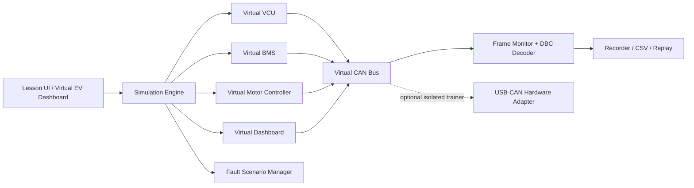

# APITech CAN Bus Education & Simulation — Developer Handoff

**Version:** 1.0 | **Date:** 22 October 2026  
**Audience:** New software developer, EV instructor, curriculum/media designer, R&D team  
**Goal:** Develop a safe, repeatable CAN Bus learning platform for motorcycle and EV ECU training.

## 1. Project overview

Build **APITech CAN Studio (Education Edition)**, a teaching-oriented simulation application. Learners must be able to see how ECU nodes exchange CAN messages, inspect raw frames, decode signals, and diagnose simulated faults **without needing a real vehicle**. Later phases may connect to an isolated physical CAN trainer.

Reference curriculum: *หลักสูตร CAN Bus ในรถจักรยานยนต์*, Train-the-Trainer, 3 days / 18 hours, with 9 learning modules, 6 worksheets, pre/post tests and example DBC/log exercises. This handoff adapts those principles for EV VCU, BMS, Motor Controller, Dashboard and Charger.

### Success criteria
- A new learner can identify CAN-H, CAN-L, termination, CAN frame, ID and payload.
- A learner can use an interactive simulator to observe CAN traffic and decode RPM, SOC and battery voltage.
- An instructor can pause, reset and replay the same scenario for every class.
- The developer can add scenarios, signals and lesson content through data files without rewriting the UI.

## 2. Target learners and learning levels

| Level | Learner | Learning outcome |
|---|---|---|
| L1 Basic | Vocational students / mechanics | Understand wiring, differential signaling, termination, message ID and frames |
| L2 Intermediate | Teachers / technicians | Filter CAN logs, interpret raw data, calculate scaling/offset and create DBC |
| L3 Developer | Engineering students / programmers | Simulate multiple ECUs, build signal decoders, log/replay, validate message timing and diagnose faults |

## 3. Learning content map (8 units)

| Unit | Concept | Visual teaching asset | Simulation / assessment |
|---|---|---|---|
| 1 | Vehicle networks: CAN vs LIN, UART, K-Line; CAN vs CAN FD | EV architecture: VCU–BMS–Motor Controller–Dashboard–Charger | Click nodes to reveal transmitted/received signals |
| 2 | Physical layer: CAN-H/L, twisted pair, termination, differential levels | Wiring and oscilloscope animation | Compare healthy bus and missing termination |
| 3 | Classical CAN frame: SOF, arbitration ID, control, data, CRC, ACK, EOF | Animated bit-level frame | Identify 11-bit vs 29-bit ID; DLC and payload |
| 4 | Arbitration, message priority, bit timing, errors | Two nodes transmitting concurrently | Predict which lower numerical ID wins arbitration |
| 5 | Data decoding: bits, bytes, endian, signedness, scale, offset | Raw hex → engineering values | Decode RPM/SOC/voltage; verify with DBC |
| 6 | Live monitoring and logging | CAN monitor, graphs, timeline | Filter IDs, record/export CSV, replay data |
| 7 | EV application and diagnostic concepts | ECU network + virtual dashboard | Observe VCU/BMS/Motor Controller state changes and missing-message alerts |
| 8 | Troubleshooting and project | Fault scenario board + quiz | Diagnose wiring/termination/timeout and build a mini dashboard |

**Teaching rule:** clearly distinguish generic teaching frames from OEM-specific frames. All example IDs below are **APITech synthetic training IDs**, not claimed vehicle manufacturer specifications.

## 4. System architecture



**MVP architecture:** browser UI + deterministic simulator; use TypeScript/React for frontend and pure TypeScript engine (or Python backend if required by the team). Keep CAN protocol model independent from rendering and hardware drivers. A virtual CAN frame is not the same as a bit-accurate electrical simulation; show waveform illustrations separately unless a validated physical-layer model is implemented.

### Core components
1. **Lesson Player:** objectives, diagrams, explanations, step-by-step prompts, questions.
2. **Vehicle Topology:** clickable virtual ECU nodes, links and termination indicators.
3. **Scenario Engine:** ignition on/off, throttle, brake, SOC decrease, motor speed, time-based signals.
4. **CAN Monitor:** timestamp, channel, ID, IDE, DLC, payload, direction/source, cycle time and filters.
5. **Signal Decoder:** DBC import, bit extraction, endian, signed, scale/offset and units.
6. **Dashboard:** gauges for RPM, SOC, voltage, current, temperature and simulated faults.
7. **Fault Lab:** instructor-controlled missing messages, incorrect bit rate and termination teaching scenarios.
8. **Record & Replay:** CSV export/import and playback at adjustable speed.
9. **Instructor Mode:** reset scenario, lesson presets, answer key, quiz results.

## 5. Simulation data contract

Use configurable JSON/YAML for virtual ECU definitions, signal mapping, messages, lessons and faults. Sample below is a **fictional classroom CAN network** at 500 kbit/s using Classical CAN with 11-bit IDs and up to 8 data bytes.

| ID (hex) | Publisher | Period | Payload mapping (training only) |
|---|---|---|---|
| 0x180 | Motor Controller | 100 ms | bytes 0–1: RPM unsigned little-endian, scale 1 rpm/bit; byte 2: motor temperature, offset −40 °C |
| 0x280 | BMS | 500 ms | bytes 0–1: pack voltage unsigned little-endian, scale 0.1 V/bit; byte 2: SOC, scale 1%/bit |
| 0x380 | VCU | 100 ms | byte 0: throttle 0–100%; byte 1 bit 0: brake; byte 1 bit 1: drive enable |

Example: ID `0x280`, data `E0 01 50 00 00 00 00 00` → voltage raw `0x01E0` = 480 → **48.0 V**; SOC `0x50` = **80%**. The simulator should expose both the bytes and the calculation.

```json
{
  "scenario_id": "ev_basic_drive_01",
  "network": {"protocol": "classical_can", "bitrate": 500000, "id_format": "standard_11bit"},
  "message": {"id": "0x280", "dlc": 8, "data_hex": "E0 01 50 00 00 00 00 00", "period_ms": 500},
  "signals": [
    {"name": "PackVoltage", "start_bit": 0, "length": 16, "byte_order": "little_endian", "signed": false, "factor": 0.1, "offset": 0, "unit": "V"},
    {"name": "SOC", "start_bit": 16, "length": 8, "byte_order": "little_endian", "signed": false, "factor": 1, "offset": 0, "unit": "%"}
  ]
}
```

Validation: ID range, DLC/payload consistency, signal bit overlap, physical min/max, update period and units. CAN FD requires a separate model supporting its DLC mapping, payload up to 64 bytes and distinct nominal/data bit rates.

## 6. User experience / required screens

1. **Home:** choose Basic, Decode, EV Simulation, Fault Lab, Instructor Mode.
2. **Learn:** left panel lesson outline; center animated diagram; right panel explanation and quiz.
3. **Virtual EV:** ignition switch, throttle slider, brake switch, battery SOC slider; gauges update with frames.
4. **CAN Monitor:** sortable frame table, ID filters, raw hex, decoded values, timestamp and pause/resume.
5. **Frame Inspector:** show field-by-field structure and byte/bit highlighting.
6. **DBC Lab:** load provided `.dbc`, edit signal factor/offset/endian and compare outputs.
7. **Fault Lab:** select a predefined fault, see symptoms, answer diagnosis, reveal explanation.
8. **Instructor:** lesson selector, class reset, scripted demonstration and downloadable worksheet.

### Teaching visuals to produce
- Motorcycle/EV network wiring diagram with VCU, BMS, Motor Controller and Dashboard.
- CAN-H/CAN-L differential waveforms: recessive nominally ~2.5 V on each wire; dominant nominally CAN-H ~3.5 V, CAN-L ~1.5 V **for typical high-speed CAN transceivers** (actual measurements vary).
- Two 120 Ω end resistors; approximately 60 Ω across CAN-H/L when power is off and both are present, provided no other parallel loads distort the reading.
- Frame structure, arbitration animation, hex-to-decimal/DBC animation, fault-vs-normal comparison.

## 7. Interactive workshops

| Lab | Learner action | Expected output |
|---|---|---|
| W1 | Switch ignition on and observe network | Identify which ECU sends which frame |
| W2 | Change throttle slider | VCU frame changes; simulated motor RPM follows defined model |
| W3 | Inspect `0x280` | Calculate pack voltage 48.0 V and SOC 80% |
| W4 | Apply ID filter | Only selected message IDs remain visible |
| W5 | Load DBC | Raw payload turns into named signals and units |
| W6 | Simulate missing BMS messages | Timeout warning and correct diagnosis |
| W7 | Remove one termination in teaching model | Explain expected signal integrity problems; distinguish electrical illustration from actual software frame loss |
| W8 | Record/replay drive scenario | Reproduce graph and timeline from saved log |

## 8. Safety and scope boundaries

- MVP is **simulation only**; do not send control frames to an actual EV, traction inverter, BMS, charger or ABS.
- Optional real CAN connection defaults to **listen-only**, with a clearly displayed hardware channel state. Hardware TX disabled in education mode.
- Use an electrically isolated bench trainer and low-voltage supply for hands-on activities. Never connect directly to EV high-voltage traction components.
- Fault injection and message replay operate only on the virtual network or an explicitly isolated training rig, never on an operational vehicle.
- OEM CAN IDs, DBC files, security access and diagnostics must be sourced/verified per vehicle model and legal authorization; no guesses presented as facts.

## 9. Development phases and deliverables

| Phase | Priority | Deliverable | Acceptance check |
|---|---|---|---|
| P0 Foundation | Must | Repo, UI wireframes, lesson schema, synthetic DBC, simulator architecture | Demo topology and deterministic test scenario |
| P1 MVP | Must | Virtual EV, 3 nodes + dashboard, CAN monitor, hex decode, basic lessons | Throttle/SOC update; correct `0x280` decode; pause/reset |
| P2 Teaching | High | 8 units, quizzes, worksheets, guided scenarios, log export/replay | Instructor completes 6+ workshops without hardware |
| P3 Advanced | Medium | DBC editor, fault lab, timing analysis, assessment dashboard | Correct signal decode and missing-message diagnosis |
| P4 Hardware | Later | Isolated USB-CAN listen-only adapter integration | Validated on bench; zero transmitted frames in read-only mode |
| P5 Extensions | Later | CAN FD, UDS concepts, AI log explanation | Separately specified and tested; AI labels uncertain conclusions |

**Suggested first sprint (2 weeks):** day 1–2 schema/wireframes; day 3–5 virtual frame scheduler and ECU state; day 6–8 monitor and decoder; day 9–10 example lesson, tests and demonstration. This is a planning estimate, not a committed delivery date.

## 10. Acceptance tests for programmer

- With input `E0 01 50 00 00 00 00 00` on ID `0x280`, UI displays **48.0 V / 80%**.
- Each message uses the configured period; timestamps are monotonic; pause freezes simulation state.
- Switching scenario and pressing Reset returns deterministic initial values.
- DBC decoder correctly handles little-endian and big-endian signals using tested fixtures.
- Invalid DLC, invalid hex payload and overlapping signal definitions produce understandable errors.
- Missing BMS frames trigger timeout after a **configurable** threshold, not a hardcoded OEM assumption.
- CSV replay reproduces event order and decoded signal values.
- Every lesson includes learning objective, instructor note, interaction and knowledge check.
- Education build never sends CAN frames to a real connected vehicle.

## 11. Handoff package and responsibilities

**Programmer:** frontend, simulation engine, message schema, decoder, tests, logging, installation/readme.  
**EV instructor:** verify technical accuracy, learning objectives, exercises and expected answers.  
**Media designer:** diagrams, animations, screenshots, icons and narration scripts.  
**R&D/hardware:** define optional isolated CAN trainer, adapter pinout, bench test and electrical safety review.

Required repository layout:

```text
apitech-can-education/
  README.md
  docs/requirements.md
  docs/lesson-plan.md
  docs/instructor-guide.md
  src/simulator/
  src/decoder/
  src/ui/
  content/lessons/
  content/scenarios/
  content/dbc/
  content/quizzes/
  assets/diagrams/
  tests/
```

## 12. Open decisions before implementation

- Target: browser-first offline-capable web app or Windows desktop app?
- Language: Thai-only MVP or Thai/English switch?
- Will phase 1 include only software simulation or a physical CAN training panel?
- Hardware preference for later phase: USB-CAN, STM32 FDCAN, ESP32 with compatible transceiver?
- Instructor assessment: local quiz scoring only or LMS integration?

**Recommended MVP default:** offline-capable browser application, Thai UI with English technical terms, synthetic EV network, no real hardware control. Deliver a demonstrable learning product before extending to OEM diagnostics.

---

**Reference:** APITech source curriculum, *หลักสูตร CAN Bus ในรถจักรยานยนต์* (Train-the-Trainer, 18 hours), especially the CAN physical layer, frame analysis, DBC decoding, log-based teaching and training simulator sections. This specification is a development adaptation, not a verbatim copy of that curriculum.
