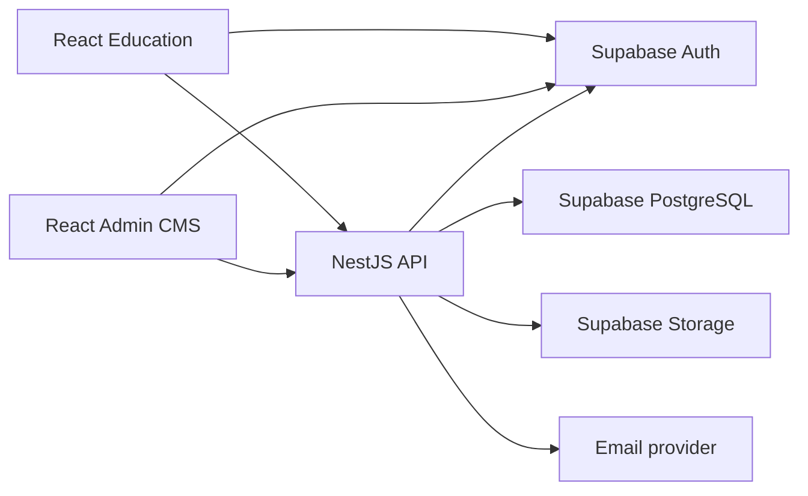

# Architecture และแนวทางดูแลโปรเจกต์

สถานะ: ตั้งต้น npm workspaces และ NestJS แล้ว ยังไม่ได้ทำระบบสมาชิกหรือเปลี่ยนฐานข้อมูลจริง

## ส่วนประกอบ

แผนภาพคือสถาปัตยกรรมเป้าหมาย การเชื่อมต่อที่ใช้ได้ตอนนี้มีเพียง Admin → API health
Supabase browser client ยังไม่ได้เชื่อม flow login หรือระบบสมาชิก

## หลักการ

- ใช้ repo เดียว ติดตั้งจาก root ด้วย npm install และ lockfile เดียว
- Education และ Admin เป็นคนละ React app ไม่ bundle โค้ด CMS ไปกับหน้า Education
- NestJS/TypeScript บน Node.js เป็นบริการเดียวแบ่งโมดูลภายใน ยังไม่ใช่ microservices
- แต่ละแอป build/deploy แยกได้ ไม่ต้องเพิ่ม message broker หรือ orchestration ในตอนนี้

## หน้าที่และตำแหน่งงาน

| งาน | โฟลเดอร์ |
|---|---|
| หน้าเรียนและ EV/CAN | `apps/education-web/src/ui/` |
| Simulation/Decoder | `apps/education-web/src/simulator/`, `decoder/` |
| หน้า Admin | `apps/admin-web/src/` |
| การตรวจ token/สิทธิ์ (ถัดไป) | `apps/api/src/modules/auth/` |
| สมาชิก/การอนุมัติ (ถัดไป) | `apps/api/src/modules/members/` |
| สถาบัน (ถัดไป) | `apps/api/src/modules/institutions/` |
| บทเรียน/Publish/Rollback (ถัดไป) | `apps/api/src/modules/content/` |
| Notification/Email (ถัดไป) | `apps/api/src/modules/notifications/` |
| ประวัติ (ถัดไป) | `apps/api/src/modules/audit/` |
| API contracts | `packages/contracts/src/` |
| Schema, grants, RLS, RPC | `supabase/migrations/` เมื่อเริ่มงานฐานข้อมูล |

โมดูลในอนาคตยังไม่สร้างไฟล์ dummy ให้เข้าใจผิดว่าทำแล้ว
เมื่อเริ่มแต่ละโมดูล แบ่ง controller (HTTP), service (กติกางาน), DTO (ตรวจ input) และ repository/adapter (เข้าข้อมูล)
Frontend ห้าม import Server implementation; API ห้าม import React/store ของ Frontend
packages/contracts เป็น type-only API types ไม่ส่ง database entities หรือ secret ข้ามแอป
ต้องตรวจ input/runtime แยกจาก TypeScript types

## เส้นทางข้อมูลที่เลือก

1. Signup/Login/ยืนยันอีเมล/ลืมรหัสผ่านผ่าน Supabase Auth SDK ใน browser
2. Frontend ส่ง access token ไป NestJS ผ่าน Authorization Bearer
3. API ตรวจ JWT และสิทธิ์ปัจจุบันจากฐานข้อมูล ไม่เชื่อ role/status ใน browser payload
4. ข้อมูลธุรกิจทั้งหมด รวมถึงสถาบันสำหรับ Register, สมาชิก, CMS, Notification และ audit ผ่าน API กลาง
5. API เรียก PostgreSQL RPC ด้วย JWT ผู้เรียกเพื่อคง RLS และ transaction ของงานที่เปลี่ยนหลายตาราง
6. Database ยังบังคับ constraints/grants/RLS ป้องกันการข้าม API แล้วเรียก Supabase โดยตรง
7. RPC ที่อนุญาตด้วย JWT ต้องตรวจสิทธิ์และกติกาครบ แม้ UI เรียกผ่าน NestJS: ฟังก์ชันเหล่านี้ไม่ใช่ความลับและการตรวจเฉพาะใน API ไม่เพียงพอ
8. Worker อีเมลใช้สิทธิ์ Server ที่จำกัดขอบเขต รับงานจาก outbox ไม่เปลี่ยนข้อมูลตาม email/role ที่ browser ส่งมาโดยตรง

API กลางเป็นเส้นทางของ application ไม่ได้แปลว่า Supabase Data API ปิดอยู่แล้ว
RLS/grants/RPC ในแบบต้อง implement และทดสอบก่อนใช้งานจริง ไม่ใช้ service role ทุก request แล้วละเลยสิทธิ์รายสมาชิก

## การแบ่ง Backend

- Supabase Auth: บัญชี รหัสผ่าน email confirmation และ session
- NestJS: HTTP API, JWT verification, authorization, validation และ integrations
- PostgreSQL: constraints, transaction, concurrency, RLS และ audit ที่บันทึกพร้อมการแก้ข้อมูล
- Storage: รูปภาพและไฟล์ส่วนตัวในระยะ CMS; draft ไม่ใช้ public bucket
- Email worker: แยกหน้าที่จาก HTTP handler ใช้ outbox/lease/idempotency แม้ยังอยู่ระบบเดียว
- ไม่ทำ Edge Functions ซ้ำกับ NestJS สำหรับกติกาสมาชิกเดียวกัน
- มี migrations, Global AuthGuard และ Members API แล้ว ดู [Members API](MEMBERS_API.md); ยังไม่ apply หรือทดสอบ end-to-end บน Supabase จริง

## Environment และ deployment

- Education: `apps/education-web/.env.local` (ย้ายจาก root โดยรักษาค่าเดิม)
- Admin: `apps/admin-web/.env.local`; VITE_API_URL ใช้เมื่อ API อยู่คนละ origin
- API: `apps/api/.env.local`; รันจาก workspace API ตาม npm scripts เพื่ออ่าน env ที่ถูกต้อง
- ห้าม Frontend อ่าน env ของ API; ค่า VITE_* ถูกเปิดเผยใน browser
- Development: Education 5173, Admin 5174; proxy /api → 127.0.0.1:3000
- Production: reverse proxy /api หรือกำหนด API origin พร้อม CORS allowlist ของเว็บจริง
- CORS ไม่ใช่ authorization ทุก endpoint ข้อมูลยังต้องตรวจสิทธิ์แม้ request ไม่มี Origin
- API default HOST=127.0.0.1; hosting/container กำหนด HOST=0.0.0.0 ตามสภาพแวดล้อม
- เปลี่ยน Vite env ต้อง restart dev server หรือ rebuild เมื่อ deploy

## การย้ายโฟลเดอร์

- src/, public/, tests/, Vite/TS configs และ env เดิม → apps/education-web/
- Export script → apps/education-web/scripts/export-html.mjs; ผลลัพธ์อยู่ dist ของแอป
- content/ คงที่ root เป็น source configuration/fixtures ไม่ใช่ฐานข้อมูล production
- docs เก็บ RQM ต้นฉบับและข้อตกลง โดยไม่แก้ต้นฉบับลูกค้า
- root dist/ จาก build เก่าอาจยังอยู่ในเครื่อง เป็น artifact เก่าที่ ignore ไม่ใช่ build ปัจจุบัน
- legacy UI, HTML ตัวอย่างและรูปที่ ignore ถูกย้ายพร้อมแอป แต่ไม่เพิ่มเข้า Git
- ไม่เปลี่ยน geometry/ชื่อของ GLB และไม่เปลี่ยน UI Education ระหว่างย้าย

## ขั้นต่อไป

สรุปแบบสมาชิก/RLS → สร้างและทดสอบ migrations → auth guard + members API → Login/Register + Admin อนุมัติ → CMS บทเรียนและเวอร์ชัน

## การตรวจรอบจัดโครงสร้าง

- ติดตั้ง npm workspaces สำเร็จ ใช้ root lockfile เดียว
- Build ผ่านทุกแอป/contracts; lint ไม่มี error แต่มีคำเตือนเดิม 2 รายการของ MotorCameraRig และ build เตือนขนาด chunk 3D
- Motor tests ผ่าน 6 กรณี; API HTTP/config tests ผ่าน 2 กรณี
- dev:all เปิดสามบริการได้; HTTP ของสองเว็บ, /api proxy ทั้งสอง และ GLB ผ่าน
- Export HTML สำเร็จ ตรวจ syntax ของ script และ hash ของ GLB ที่ฝังตรงกับต้นฉบับ
- ตรวจไฟล์ที่ย้ายจาก Git เดิมครบและ source Viewer ไม่เปลี่ยน; env/ไฟล์ลูกค้า local-only ยังถูก ignore
- ยังไม่ได้ตรวจหน้าจอผ่าน browser จริงในรอบนี้ ไม่ได้เชื่อม database/JWT หรือทดสอบสิทธิ์สมาชิก
- ยังไม่ได้ Commit, Push หรือ Deploy งานรอบนี้

อ้างอิง: [NestJS first steps](https://docs.nestjs.com/first-steps), [npm workspaces](https://docs.npmjs.com/cli/using-npm/workspaces/)
