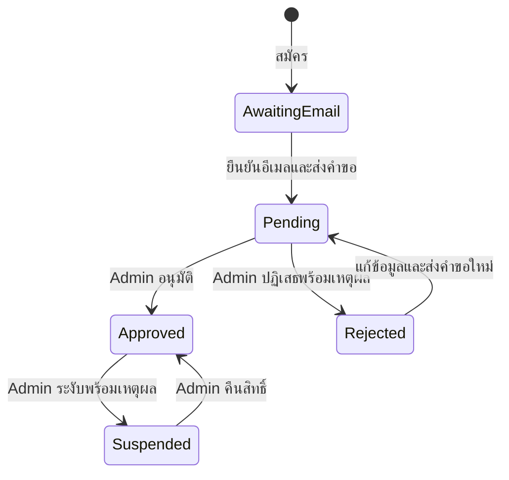

# ออกแบบระบบสมาชิกและสิทธิ์เข้าถึง

วันที่: 10 พฤศจิกายน 2026
Branch: `features/member-access-foundation`
สถานะ: มี SQL migrations, local PostgreSQL tests และ NestJS members endpoints แล้ว Apply บน Supabase จริงเมื่อ 13 พฤศจิกายน 2026 แต่ยังไม่ทดสอบ signup/approval end-to-end
ผลตรวจ schema/grants/Auth triggers ดูที่ [บันทึก deployment](SUPABASE_DEPLOYMENT_2026-11-13.md)

ข้อกำหนดอ้างอิง: [ข้อตกลงสมาชิกและ CMS](MEMBERSHIP_CMS_AGREEMENTS.md)
เอกสารนี้ระบุแนวทาง implementation ที่เสนอ แยกจากข้อกำหนดที่ตกลงแล้ว หากมีรายละเอียดใหม่ด้านพฤติกรรม ให้ตรวจร่วมกันก่อนนำไปใช้

สถาปัตยกรรมล่าสุดเลือก React สองแอปและ NestJS API ใน monorepo ตาม [ARCHITECTURE.md](ARCHITECTURE.md)
Auth SDK ใช้ใน browser สำหรับบัญชี/session ส่วนข้อมูลธุรกิจให้เรียกผ่าน NestJS API ซึ่งตรวจ JWT และเรียก RPC ด้วย JWT ผู้เรียกเพื่อคง RLS
API ที่ implement แล้วดูที่ [MEMBERS_API.md](MEMBERS_API.md) รายละเอียดในแบบที่ยังไม่มี endpoint ให้ถือเป็นแผนระยะถัดไป

รายละเอียด implementation/test ล่าสุดดูที่ [Supabase README](../supabase/README.md)
SQL ใช้ชื่อ parameters แบบ `p_*`; การปิดสถาบันใช้ `save_institution(..., p_active=false, ...)`
สถาบันมี version เพิ่มเพื่อป้องกันการแก้ทับกัน และ get_my_access คืน JSON ของบัญชี/คำขอล่าสุด
Local tests ยืนยัน SQL/grants/RLS บน PGlite แต่ยังไม่ยืนยัน Supabase Auth/PostgREST integration หรือหลาย connection พร้อมกัน

## 1. ขอบเขตรอบแรก

ทำฐานข้อมูลสมาชิก สถาบัน การอนุมัติ สิทธิ์ การแจ้งเตือน และประวัติให้ครบ
ยังไม่ทำตารางเนื้อหาและหน้าจอ CMS ในรอบนี้ แต่ audit log ต้องรองรับงานเหล่านั้นภายหลัง

- `instructor`: อาจารย์ที่สมัครด้วยตนเอง ต้องยืนยันอีเมลและผ่านอนุมัติ
- `admin`: Dev เป็นผู้กำหนดสิทธิ์ ไม่มี API ให้สมาชิกหรือ Admin ตั้งบทบาทนี้เอง
- บทบาทกับสถานะอนุมัติเป็นคนละข้อมูล
- ทุกหมวด Education ใช้สิทธิ์เดียวกัน ไม่มีตารางอนุญาตแยกตามหมวด
- Supabase Auth ดูแลอีเมล รหัสผ่าน และ session ไม่ทำตารางรหัสผ่านซ้ำ

## 2. ตารางที่เสนอ

ใช้ UUID เป็น primary key, เวลาเป็น `timestamptz` จาก Server และใช้ UTC ในฐานข้อมูล
ตาราง application ใน `public` เปิด RLS ตั้งแต่สร้าง ส่วนงานอีเมลภายในเก็บใน `private` ซึ่งไม่ expose ผ่าน Data API

| ตาราง | ข้อมูลหลัก | หน้าที่ |
|---|---|---|
| `public.institutions` | `id`, `name`, `is_active`, `created_at`, `updated_at` | รายชื่อสถาบันที่ Admin จัดการ |
| `public.profiles` | `user_id`, `full_name`, `institution_id`, `institution_other`, `created_at`, `updated_at`, `revision` | ข้อมูลที่สมาชิกกรอก แยกจากข้อมูลสิทธิ์ |
| `public.member_access` | `user_id`, `role`, `status`, `version`, `changed_at` | สิทธิ์ปัจจุบัน เปลี่ยนผ่านฟังก์ชันที่กำหนดเท่านั้น |
| `public.membership_requests` | `id`, `user_id`, `round_no`, `profile_snapshot`, `status`, `submitted_at`, `reviewed_at`, `reviewed_by`, `reason`, `version` | คำขอแต่ละรอบและข้อมูล ณ เวลาส่ง |
| `public.membership_events` | `id`, `user_id`, `request_id`, `action`, `from_status`, `to_status`, `actor_id`, `reason`, `created_at` | ประวัติที่สมาชิกอ่านของตัวเองได้ |
| `public.admin_notifications` | `id`, `recipient_id`, `request_id`, `event_id`, `created_at`, `read_at` | แจ้งเตือนใน CMS แยกรับทราบของ Admin แต่ละคน |
| `public.audit_logs` | `id`, `actor_id`, `actor_kind`, `action`, `entity_type`, `entity_id`, `before_data`, `after_data`, `created_at`, `correlation_id` | ประวัติเปลี่ยนแปลงสำหรับ Admin ตรวจย้อนหลัง |
| `private.email_outbox` | `id`, `membership_event_id`, `template`, `status`, `attempts`, `next_attempt_at`, `locked_until`, `provider_message_id`, `last_error`, `created_at`, `sent_at` | คิวอีเมลและการส่งซ้ำ เฉพาะ worker อ่าน/เปลี่ยนได้ |

`auth.users` เป็นข้อมูลที่ Supabase จัดการ ไม่นับเป็นตารางที่เราสร้าง
`profiles.user_id` และ `member_access.user_id` ใช้ PK/FK อ้าง `auth.users.id`
ไม่ใส่อีเมลหรือ role ที่ผู้ใช้ส่งมาเป็นแหล่งตัดสินสิทธิ์

### กฎข้อมูล

- `role` รับเฉพาะ `instructor` / `admin`; การสมัครบังคับ `instructor` ฝั่ง Server เสมอ
- `member_access.status` รับ `pending` / `approved` / `rejected` / `suspended`
- `membership_requests.status` รับ `pending` / `approved` / `rejected` ไม่ใช้คำขอเดิมบันทึกการระงับ
- หนึ่งคนมี pending request ได้ไม่เกินหนึ่งรายการ ใช้ partial unique index บังคับ
- `(user_id, round_no)` ต้องไม่ซ้ำ; ให้ Server คำนวณรอบภายใต้ lock
- profile เลือกสถาบันจากรายการ หรือกรอกชื่ออื่น หรือเว้นว่างได้ แต่ห้ามเลือกและกรอกอื่นพร้อมกัน
- ชื่อสถาบันตรวจซ้ำแบบไม่สนตัวพิมพ์/ช่องว่างหัวท้ายก่อนบันทึก ไม่ลบสถาบันที่มีสมาชิกอ้างถึง ให้ปิดใช้งานแทน
- ผู้สมัครใหม่เลือกได้เฉพาะสถาบัน active; สมาชิกเดิมยังเห็นชื่อสถาบันที่เคยเลือกแม้ปิดแล้ว
- `profile_snapshot` เก็บชื่อและชื่อสถาบัน ณ เวลาส่ง รวมถึง ID ไม่อาศัยชื่อปัจจุบันที่ Admin อาจแก้ภายหลัง
- เหตุผลปฏิเสธและระงับต้องไม่เป็นข้อความว่าง เหตุผลคืนสิทธิ์เสนอให้กรอกได้แต่ไม่บังคับ
- `version`/`revision` ใช้ตรวจการแก้พร้อมกัน ไม่ใช้เวลาใน browser เป็นตัวตัดสิน
- ไม่เปิดการลบบัญชีจริงใน CMS รุ่นแรก; การเก็บ/ลบข้อมูลส่วนบุคคลและ retention ต้องออกแบบก่อน production
- ประวัติไม่ cascade delete ตามผู้ใช้ หาก Dev ต้องลบบัญชีให้มีขั้นตอนรักษาประวัติ/ลดข้อมูลส่วนบุคคลอย่างชัดเจน

## 3. สถานะและการเปลี่ยนสถานะ

การยืนยันอีเมลอ่านจาก `auth.users.email_confirmed_at` ไม่เชื่อ `user_metadata` หรือสถานะที่ browser ส่งมา
`pending` หลังสมัครยังไม่แปลว่าอยู่ในคิว Admin: ต้องมีคำขอที่ส่งแล้วหลังยืนยันอีเมลด้วย

| เหตุการณ์ | ก่อน | หลัง | ผู้ทำรายการ |
|---|---|---|---|
| สมัคร | ไม่มีบัญชี | instructor / pending แต่ยังไม่มีคำขอ | Auth + ระบบ |
| ยืนยันอีเมลและข้อมูลครบ | pending ไม่มีคำขอ | pending + คำขอรอบแรก | ระบบ |
| อนุมัติคำขอ | pending | approved | Admin |
| ปฏิเสธคำขอพร้อมเหตุผล | pending | rejected | Admin |
| แก้ข้อมูลและส่งใหม่ | rejected | pending + คำขอรอบถัดไป | เจ้าของบัญชี |
| ระงับพร้อมเหตุผล | approved | suspended | Admin |
| คืนสิทธิ์ | suspended | approved | Admin |

ไม่อนุญาต suspended → pending ด้วยคำขอของสมาชิก และไม่อนุญาต approved → rejected
งาน Admin ใน CMS ใช้กับบัญชี instructor เท่านั้น การเปลี่ยนสิทธิ์บัญชี Admin ให้ Dev ดูแล

`AwaitingEmail` เป็นสถานะหน้าจอที่คำนวณ ไม่ใช่ค่าเพิ่มใน `member_access.status`
กรณีข้อมูลไม่ครบให้เข้าหน้ากรอกข้อมูลก่อนส่งคำขอ ไม่ให้ trigger ที่ตรวจข้อมูลส่วนตัวล้มจนยืนยันอีเมลไม่ได้

## 4. Signup และเข้าคิวพิจารณา

1. หน้า Register ส่งชื่อ/สถาบันเป็น metadata สำหรับตั้งต้นเท่านั้น ไม่รับ role/status จากผู้สมัคร
2. Trigger หลังสร้าง `auth.users` สร้าง profile และ member_access ค่าเริ่มต้น pending/instructor
3. เปิด Confirm email ใน Supabase Auth; login/password reset ใช้ Auth SDK
4. Trigger หลัง `email_confirmed_at` เปลี่ยนจาก null เป็นมีค่า เรียก helper ภายในเพื่อสร้างคำขอ หากข้อมูลผ่าน validation
5. Helper ต้อง idempotent: callback ซ้ำไม่เพิ่มคำขอรอบแรกหรือการแจ้งเตือนซ้ำ
6. เมื่อ login สำเร็จให้ตรวจข้อมูลและเรียก submit ครั้งแรกเป็น fallback หากไม่มีคำขอและข้อมูลครบ
7. หาก metadata ไม่ครบ/ผิดรูปแบบ ให้เก็บเฉพาะค่าที่ปลอดภัยและให้สมาชิกกรอกให้ครบก่อน submit ไม่ใช้ข้อมูลนั้นตัดสินสิทธิ์
8. หากตาราง access/profile หายหรืออ่านไม่ได้ ให้ปฏิเสธการเข้าหน้าเรียนและแสดงให้ลองใหม่ ไม่ถือว่า approved

เสนอให้ freeze ข้อมูลที่ใช้พิจารณาระหว่างคำขอ pending เพื่อไม่ให้ snapshot กับสิ่งที่ Admin เห็นต่างกัน
ผู้ถูกปฏิเสธแก้ข้อมูลแล้ว submit ใหม่ได้ ส่วน approved แก้ข้อมูลพื้นฐานได้โดยไม่เปลี่ยนสิทธิ์หรือประวัติคำขอเดิม
รายละเอียดนี้เป็นข้อเสนอการทำงาน ไม่ใช่ข้อกำหนดเพิ่มเติมจากลูกค้า

## 5. สิทธิ์และ RLS

ตรวจสถานะจากฐานข้อมูลทุกครั้งที่อ่าน/เขียนข้อมูลที่จำกัดสิทธิ์ ไม่พึ่ง role/status ใน JWT อย่างเดียว เพราะ token เดิมอาจยังไม่หมดอายุหลังระงับ

| การกระทำ | ยังไม่ login | สมาชิก pending/rejected/suspended | อาจารย์ approved | Admin ที่เปิดสิทธิ์ |
|---|---|---|---|---|
| รายชื่อสถาบัน active สำหรับสมัคร | อ่านชื่อ/ID | อ่าน | อ่าน | อ่านทั้งหมด |
| Profile ของตัวเอง | ไม่ได้ | อ่าน/แก้ตามสถานะผ่าน RPC | อ่าน/แก้ผ่าน RPC | อ่าน |
| Profile คนอื่น | ไม่ได้ | ไม่ได้ | ไม่ได้ | อ่านเพื่อจัดการสมาชิก |
| Role/status ตัวเอง | ไม่ได้ | อ่านเท่านั้น | อ่านเท่านั้น | อ่านเท่านั้น |
| เปลี่ยน role / สร้าง Admin | ไม่ได้ | ไม่ได้ | ไม่ได้ | ไม่ได้; Dev เท่านั้น |
| คำขอและผลพิจารณาของตัวเอง | ไม่ได้ | อ่าน; submit ตาม transition | อ่าน | อ่าน instructor ทุกคน |
| อนุมัติ/ปฏิเสธ/ระงับ/คืนสิทธิ์ | ไม่ได้ | ไม่ได้ | ไม่ได้ | ผ่าน RPC ที่ตรวจสิทธิ์ |
| จัดการสถาบัน | ไม่ได้ | ไม่ได้ | ไม่ได้ | ผ่าน RPC ที่มี audit |
| Notification ใน CMS | ไม่ได้ | ไม่ได้ | ไม่ได้ | อ่าน/mark-read เฉพาะของตัวเอง |
| Audit log | ไม่ได้ | ไม่ได้ | ไม่ได้ | อ่านเท่านั้น |
| Email outbox | ไม่ได้ | ไม่ได้ | ไม่ได้ | ไม่ได้; worker เท่านั้น |
| เนื้อหาที่เผยแพร่ (ระยะ CMS) | ไม่ได้ | ไม่ได้ | อ่าน | อ่าน |
| ร่างและประวัติเนื้อหา (ระยะ CMS) | ไม่ได้ | ไม่ได้ | ไม่ได้ | อ่าน/จัดการผ่านขั้นตอนที่กำหนด |

- ตาราง public ให้สิทธิ์ SELECT เท่าที่จำเป็น และ RLS จำกัดแถว
- การเขียนข้อมูลสำคัญ revoke direct INSERT/UPDATE/DELETE แม้เป็น Admin ใช้ RPC เฉพาะงานเพื่อบังคับ transition, validation และ audit
- Profile ไม่ใช้ policy ที่เปิด UPDATE ทั้งแถวแล้วหวังให้ UI ป้องกัน ใช้ RPC ที่รับเฉพาะ full_name/institution
- สร้าง helper ใน private schema เช่น `is_active_admin()` และ `can_access_education()` เพื่อหลีกเลี่ยง RLS recursion
- helper อ่าน access และสถานะ email ของผู้เรียกเท่านั้น คืน boolean ไม่เผยข้อมูล Auth ของคนอื่น
- helper แบบ SECURITY DEFINER ต้องมี `search_path = ''`, ใช้ชื่อ schema ครบ และจำกัด EXECUTE เท่าที่จำเป็น
- RPC ใน public ที่เรียกได้ผ่าน API ต้องตรวจ `auth.uid()`, role/status, target และ transition ภายในทุกครั้ง ปิด EXECUTE ของ PUBLIC/anon และ grant เฉพาะฟังก์ชันที่แต่ละบทบาทต้องเรียก
- อย่าให้ browser ส่ง `actor_id` เพื่ออ้างเป็นคนอื่น; actor มาจาก verified JWT/`auth.uid()`
- `private` ไม่อยู่ใน exposed schemas; secret/service-role key ไม่อยู่ใน browser
- หาก worker ใช้ service role ที่ bypass RLS ต้องมีขอบเขตงานจำกัดและตรวจ event ที่มาจากฐานข้อมูล ไม่รับปลายทางอีเมล/สิทธิ์ตาม browser โดยตรง

## 6. ขอบเขต API ที่เสนอ

| ชื่อเชิงแนวคิด | หน้าที่ |
|---|---|
| `get_my_access()` | คืน role/status/email-confirmed และสถานะคำขอของผู้เรียก |
| `update_my_profile(fields, expected_revision)` | แก้เฉพาะข้อมูลที่อนุญาตและเพิ่ม audit |
| `submit_membership_request(expected_revision)` | ตรวจยืนยันอีเมล/ข้อมูล สร้างรอบแรกหรือรอบใหม่หลัง rejected |
| `review_membership_request(request_id, decision, reason, expected_version)` | อนุมัติ/ปฏิเสธคำขอที่ยัง pending เท่านั้น |
| `change_member_status(user_id, action, reason, expected_version)` | ระงับหรือคืนสิทธิ์ instructor |
| `save_institution(...)` / `deactivate_institution(...)` | จัดการสถาบันพร้อม audit |
| `mark_notification_read(notification_id)` | เปลี่ยน read_at ของผู้รับคนปัจจุบันเท่านั้น |

NestJS API รับคำสั่งจาก CMS ตรวจ JWT แล้วเรียก RPC ด้วย JWT ของผู้เรียก เพื่อให้ฐานข้อมูลตรวจสิทธิ์ Admin ซ้ำ
ไม่ใช้ service role เปลี่ยนสิทธิ์ตาม payload โดยข้าม validation ในฐานข้อมูล
แต่ละ RPC จัดการ transaction เอง ไม่แบ่งการเปลี่ยนสถานะกับการเขียน audit เป็นหลายคำขอจาก browser

### ป้องกันการกดซ้ำและ Admin พิจารณาพร้อมกัน

- lock คำขอและ member_access ในลำดับเดียวกันทุกฟังก์ชัน
- ตรวจ expected_version, สถานะปัจจุบัน และยืนยันอีเมลซ้ำก่อนอนุมัติ
- สำเร็จครั้งเดียว อีกคำขอได้ conflict และให้โหลดข้อมูลใหม่
- transaction เดียวอัปเดตคำขอ/access และเพิ่ม membership_event, audit_log, email_outbox
- idempotency ของอีเมลใช้ unique `(membership_event_id, template)` ไม่สร้างเมลซ้ำจาก double-click
- notification ใช้ unique `(recipient_id, event_id)`

## 7. Notification, Email และ Audit

### Notification ภายใน CMS

- คำขอที่เข้า pending แต่ละรอบสร้างแจ้งเตือนให้ Admin ที่เปิดสิทธิ์อยู่ขณะนั้น
- Admin แต่ละคนมี read_at ของตัวเอง ไม่ mark-read ให้ทุกคนพร้อมกัน
- อ่านแจ้งเตือนไม่เท่ากับพิจารณาคำขอ; หน้า Dashboard ใช้จำนวน pending requests จริง ไม่ใช้จำนวน unread เป็นคิวงาน
- Admin ที่ถูกสร้างภายหลังยังเห็นคำขอ pending ทั้งหมดจากตารางคำขอ แม้ไม่มีแจ้งเตือนย้อนหลัง
- เริ่มด้วย fetch เมื่อเปิดหน้าและ refresh เป็นระยะ อาจเพิ่ม Realtime ภายหลังโดยคง RLS เดิม

### อีเมล

- ยืนยันอีเมล/ลืมรหัสผ่านใช้ Supabase Auth และ SMTP
- ผล approved/rejected ใช้ email_outbox + Backend worker + ผู้ให้บริการที่ตั้งค่าภายหลัง โดยไม่เพิ่ม Edge Function ที่ซ้ำกับ NestJS
- worker claim งานแบบมี lock/lease ป้องกันส่งชนกัน และ retry แบบมีช่วงหน่วง เมื่อเกินเพดานให้แสดงส่งไม่สำเร็จใน CMS สำหรับ retry
- ส่งเมลล้มเหลวไม่ย้อนผลอนุมัติ; แยกสถานะการพิจารณากับการส่งอีเมลใน UI
- ใช้ provider idempotency key เมื่อรองรับ การส่งผ่านเครือข่ายรับประกัน exactly-once ไม่ได้หาก provider ไม่รองรับ ต้องยอมรับโอกาสเมลซ้ำเมื่อ retry
- ตรวจสถานะล่าสุดก่อนส่ง: งานอนุมัติที่ถูกระงับไปแล้วหรือผลรอบเก่าที่หมดความเกี่ยวข้องให้ข้าม พร้อมบันทึกสาเหตุ
- อ่านอีเมลปัจจุบันที่ยืนยันแล้วจาก Auth ก่อนส่ง ไม่รับอีเมลปลายทางจาก browser
- ไม่ส่งอีเมลแจ้ง Admin ว่ามีผู้สมัครใหม่; การส่งเมลระงับ/คืนสิทธิ์ยังไม่ตกลง

### Audit log

- เพิ่มโดย trigger หรือ RPC ฝั่งฐานข้อมูลใน transaction เดียวกับการเปลี่ยนแปลง
- เก็บ actor, เวลา Server, action, entity, เหตุผล และ before/after เฉพาะ field ที่อนุญาต
- membership_events แยกประวัติที่เจ้าของบัญชีอ่านได้ออกจาก audit ภายในของ Admin
- ห้ามสมาชิกและ Admin แก้/ลบ audit และห้าม client เพิ่ม audit ที่ปลอม actor ได้
- ไม่ใช้ log จาก browser เป็นหลักฐานหลัก ไม่เก็บรหัสผ่าน token หรือ secret
- การอ่านรายการ/mark-read ไม่จำเป็นต้องสร้าง content revision แต่การเปลี่ยนข้อมูลธุรกิจต้องมี log
- Dev bootstrap Admin ต้องบันทึก actor_kind เป็น system/developer และเหตุผล ไม่สร้าง Admin ผ่าน signup metadata

## 8. การเข้าถึงเว็บและข้อจำกัด

| เงื่อนไข | หน้าปลายทางที่เสนอ |
|---|---|
| ไม่ login | Login/Register |
| ยังไม่ยืนยันอีเมล | แจ้งให้ตรวจอีเมล/ส่งยืนยันใหม่ |
| ข้อมูลไม่ครบและยังไม่มีคำขอ | กรอกข้อมูลให้ครบ |
| pending | รอตรวจสอบ |
| rejected | เหตุผล + แก้ข้อมูล + ส่งใหม่ |
| suspended | แจ้งระงับและช่องทางติดต่อ |
| approved instructor | Education ทุกหมวด |
| active admin | Admin CMS (แอปแยก) และดู Education |

Route guards เป็น UX; RLS เป็นการป้องกันข้อมูลจริง ต้องใช้ทั้งสองชั้น
การระงับมีผลกับคำขอข้อมูลครั้งถัดไป แม้ access token เดิมยังไม่หมดอายุ แต่ไม่สามารถเรียกคืนเนื้อหาที่ส่งถึง browser แล้ว
หน้าเว็บตรวจสถานะใหม่เมื่อกลับมาใช้งาน/เปลี่ยนหน้า และไม่ปล่อยสถานะ cached ให้เปิดข้อมูลใหม่หลังถูกระงับ

ไฟล์ใน `apps/education-web/public/` รวมถึง GLB ปัจจุบันเปิดอ่านได้โดย URL หากต้องการจำกัดไฟล์เหล่านี้ด้วยสมาชิก ต้องย้ายการเสิร์ฟไป private Storage ในงานแยก พร้อมตรวจ RLS/signed URL อายุสั้น
การมีหน้าล็อกอินอย่างเดียวไม่ทำให้ public assets หรือ simulation JavaScript กลายเป็นข้อมูลลับ
สำหรับ CMS รูป draft ต้องอยู่ private bucket ตั้งแต่เริ่ม และอนุญาตผู้เรียนอ่านเฉพาะรูปที่อ้างโดยเนื้อหาที่เผยแพร่

## 9. แผน CMS ระยะถัดไป

ออกแบบแยกอีกฉบับก่อนสร้างตาราง: บทเรียน/หัวข้อ, immutable content revisions, draft pointers, published release, images และการอ้างอิงรูป
ต้อง version โครงสร้างและลำดับบทเรียนด้วย ไม่ใช่ version เฉพาะข้อความ
Publish/rollback เปลี่ยน published release แบบ atomic เพื่อไม่ให้ผู้เรียนเห็นเนื้อหาใหม่กับลำดับเก่าปนกัน
การลบผ่าน CMS เป็น archive/tombstone ที่ตรวจย้อนหลังได้ และมีผลหน้าเรียนเมื่อเผยแพร่เท่านั้น
ไม่ลบรูปที่เวอร์ชันเผยแพร่หรือเวอร์ชันสำหรับ rollback ยังอ้างถึง

## 10. แผนตรวจสอบก่อนใช้ migrations จริง

1. สมัครโดยปลอม role/status ใน metadata แล้วยังเป็น instructor/pending เสมอ
2. ยังไม่ยืนยันอีเมลต้องไม่มี pending request ที่ Admin พิจารณาได้; callback ซ้ำไม่สร้างแจ้งเตือนซ้ำ
3. สมาชิก A อ่าน/แก้ข้อมูลของ B ไม่ได้ และเปลี่ยน role/status ของตัวเองไม่ได้
4. pending/rejected/suspended อ่านเนื้อหาที่จำกัดสิทธิ์ไม่ได้ แม้เรียก Data API โดยตรง
5. Admin เปลี่ยน role หรือจัดการบัญชี Admin ผ่าน CMS API ไม่ได้
6. ปฏิเสธ/ระงับโดยไม่มีเหตุผลไม่ได้; transition ผิดสถานะถูกปฏิเสธ
7. สอง Admin พิจารณาคำขอเดียวกันพร้อมกันสำเร็จได้ครั้งเดียว
8. resubmit เพิ่มรอบใหม่และเก็บ snapshot/เหตุผลเดิมครบ
9. ทุกการแก้ข้อมูลธุรกิจมี audit และ client/admin แก้ลบ log ไม่ได้
10. อีเมลล้มเหลวไม่ทำให้อนุมัติซ้ำ; worker retry และกันส่งชนกันได้
11. Admin A mark-read ไม่เปลี่ยน notification ของ Admin B
12. ระงับแล้ว session เดิมเข้าข้อมูลใหม่ไม่ได้ และคืนสิทธิ์แล้วเข้าได้ตามสถานะล่าสุด
13. หน้า Register อ่านสถาบันได้เฉพาะข้อมูลจำเป็น และเลือกสถาบันปิดใช้งานใหม่ไม่ได้

จะตรวจทั้ง grants, RLS, RPC EXECUTE และพฤติกรรมใน transaction ภายใต้ anon/authenticated จริง ไม่ทดสอบเฉพาะด้วย service role
มี SQL และทดสอบฐานข้อมูลในเครื่องแล้วตาม Supabase README แต่ checklist ด้าน integration/concurrency/worker ยังไม่ครบ ห้ามถือว่าระบบพร้อม production

## 11. แหล่งอ้างอิงทางเทคนิค

- [Supabase User Management](https://supabase.com/docs/guides/auth/managing-user-data): ตาราง profile อ้างอิง auth.users และ trigger สร้างข้อมูล
- [Supabase RLS](https://supabase.com/docs/guides/database/postgres/row-level-security): สิทธิ์ระดับแถวและ helper
- [Supabase Database Functions](https://supabase.com/docs/guides/database/functions): SECURITY DEFINER, search_path และ EXECUTE privileges

รายละเอียดชื่อ table/RPC และกลไก worker ในเอกสารนี้เป็นข้อเสนอของโปรเจกต์ ไม่ใช่ API ที่ Supabase สร้างให้อัตโนมัติ
